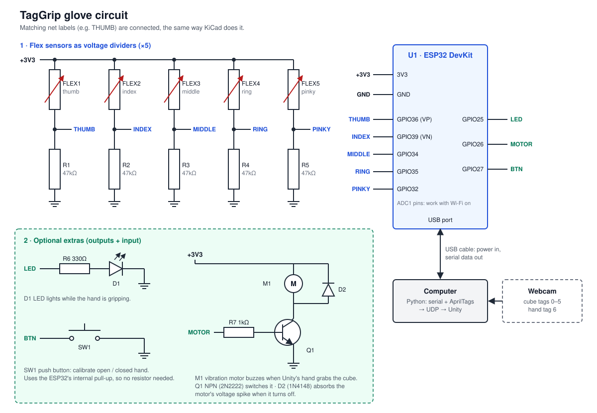

# TagGrip

TagGrip is a DIY VR glove for picking up a cube in a Unity simulation.

## Overview

- **Glove:** one flex sensor per finger, wired to an **ESP32 DevKit**. The flex sensors measure how far each finger bends, which drives the finger animation in Unity.
- **Hand tracking:** an AprilTag (ID 6) on the back of the hand gives the hand's position and rotation. All tags use the AprilTag 36h11 family.
- **Cube:** a physical cube with an AprilTag on each of its 6 faces (IDs 0–5), so the camera can see at least one face from any angle.
- **Unity:** a simulated hand that closes its fingers and picks up the cube when the flex sensors detect a grip and the hand is next to the cube.

```
Flex sensors ─► ESP32 ─(USB serial)─► Python ─(UDP)─► Unity
Webcam ─(AprilTags: cube 0–5, hand 6)─► Python ─┘
```

## Circuit



Each flex sensor is wired with a 47kΩ resistor as a voltage divider. The ESP32 reads each divider's voltage on an analog (ADC1) pin. The green section shows optional extras: a grip LED, a calibration button, and a vibration motor for haptic feedback.

## Progress

### First Arduino board test

Testing the first flex sensor setup on an Arduino Uno board, before moving to the ESP32.

[▶ Watch the test video](img/first-arduino-test.mov)

## Files

| File | Description |
|---|---|
| `cube-tags/Tag0.png` … `Tag5.png` | AprilTags for the cube faces |
| `hand-tag/Tag6.png` | AprilTag for the back of the hand |
| `camera_test.py` | Detects the AprilTags from a webcam and shows which cube faces and whether the hand are visible |
| `TagGrip-arduinoUno/` | KiCad project for the circuit |
| `img/` | Circuit diagram and test videos |

## Running the camera test

```bash
pip install opencv-contrib-python
python camera_test.py
```

Change `CAMERA_INDEX` in `camera_test.py` if the wrong camera opens. Press **Q** to quit.

## ESP32 notes

- Power the flex sensors from the **3V3** pin, not 5V. The ESP32's analog pins can't handle 5V.
- Use ADC1 pins (GPIO 32–39) for the sensors. ADC2 pins stop working when Wi-Fi is on.
- Print the AprilTags at a known size and measure the black square. That size is needed to work out real distances between the hand and the cube.
